# Diagram types: verified syntax and idioms

Every example here renders on the site's Mermaid (11.17.2) with the site theme. Copy the shape, not the content. Each entry says when the type earns its place, what to write, and what breaks.

Contents: [flowchart](#flowchart) · [architecture-beta](#architecture-beta) · [sequenceDiagram](#sequencediagram) · [stateDiagram-v2](#statediagram-v2) · [block-beta](#block-beta) · [sankey-beta](#sankey-beta) · [packet-beta](#packet-beta) · [radar-beta](#radar-beta) · [treemap-beta](#treemap-beta) · [mindmap](#mindmap) · [gitGraph](#gitgraph) · [ishikawa-beta](#ishikawa-beta) · [timeline](#timeline) · [erDiagram](#erdiagram) · [xychart-beta](#xychart-beta) · [quadrantChart](#quadrantchart) · [journey and kanban](#journey-and-kanban)

---

## flowchart

**When:** a process with decisions, a pipeline, a loop. The default for "how does this work", which is why it is overused: before writing one, check the picker for a more specific type.

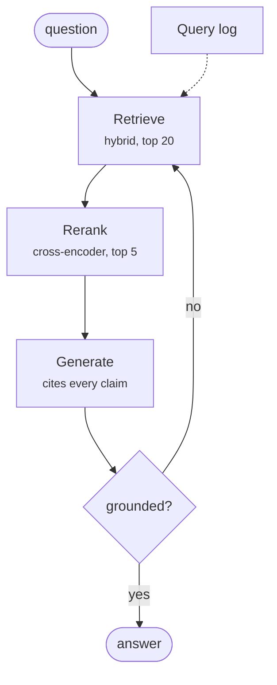

- `TD` by default. `LR` only for four nodes or fewer in a row.
- Shapes carry meaning: `(["…"])` start and end, `{"…"}` decision, `[("…")]` data store, `["…"]` step. Do not use shapes for decoration.
- Edge labels are one to three words. A sentence on an edge belongs in the prose.
- `subgraph Name["Label"]` groups by boundary (service, team, trust zone). Its label renders in small caps; keep it to one or two words.
- Math: `E["<b>E step</b> $$q \leftarrow p(z \mid x, \theta_t)$$"]`. Math in labels works in flowcharts and sequence diagrams only.

## architecture-beta

**When:** the deployed shape of a production system. Required in every post about one. It answers "what runs where, and what talks to what", which no flowchart answers as cleanly.

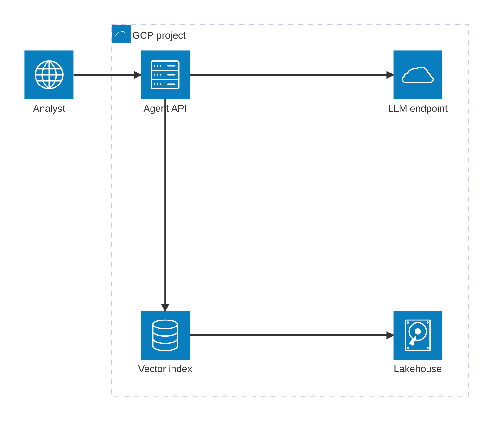

- Built-in icons: `cloud`, `database`, `disk`, `internet`, `server`. Others need an icon pack the site does not load.
- Edges name the side they leave and enter: `a:R --> L:b` (`L`, `R`, `T`, `B`). Choose sides so the drawing reads left to right, top to bottom.
- **One level of groups.** Nested groups (`group b in a`) with edges crossing between them make the layout explode into a very tall, thin drawing. Verified; avoid it.
- Labels are nouns: the service's name, not what it does. What it does goes in the paragraph.
- Six to nine services. More than that is two diagrams: the request path and the data path.

## sequenceDiagram

**When:** who talks to whom, in what order. Protocols, agent hand-offs, tool calls.

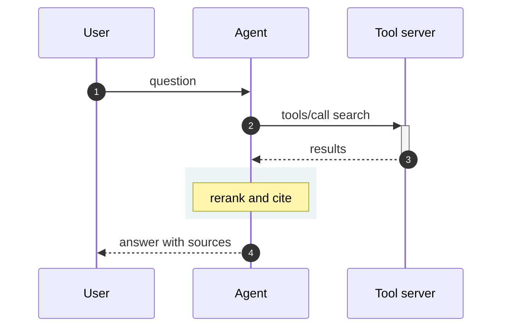

- At most five participants; the column fits no more. Short aliases (`participant A as Agent`).
- Messages under about 45 characters. The payload goes in the prose or a code block.
- `autonumber` lets the prose refer to steps ("in step 3 the agent...").
- `->>+` / `-->>-` show activation: who is busy while waiting.
- `rect rgba(…)` shades a phase. It is the only place a colour literal is tolerated; use the primary at 8 % opacity, as above.

## stateDiagram-v2

**When:** the states something moves through and what moves it. Agent loops, job lifecycles, circuit breakers.

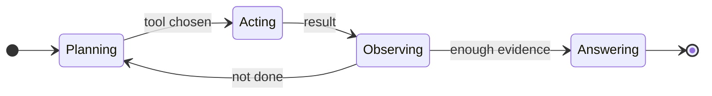

- Transition labels are the event, not the action.
- `direction LR` suits five or fewer states; otherwise leave the default vertical layout.

## block-beta

**When:** stacked layers where position means something: a platform, a memory hierarchy, a model's layers. Use it instead of a flowchart whose arrows only say "sits on top of".

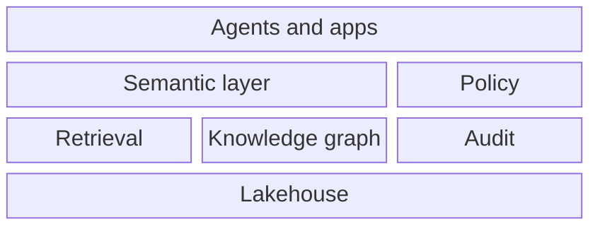

- `columns N` sets the grid; `:k` makes a block span k columns.
- Top to bottom reads as "depends on".

## sankey-beta

**When:** how a total splits and where it goes: tokens in a context window, latency in a request, rows through a pipeline. Needs real quantities.

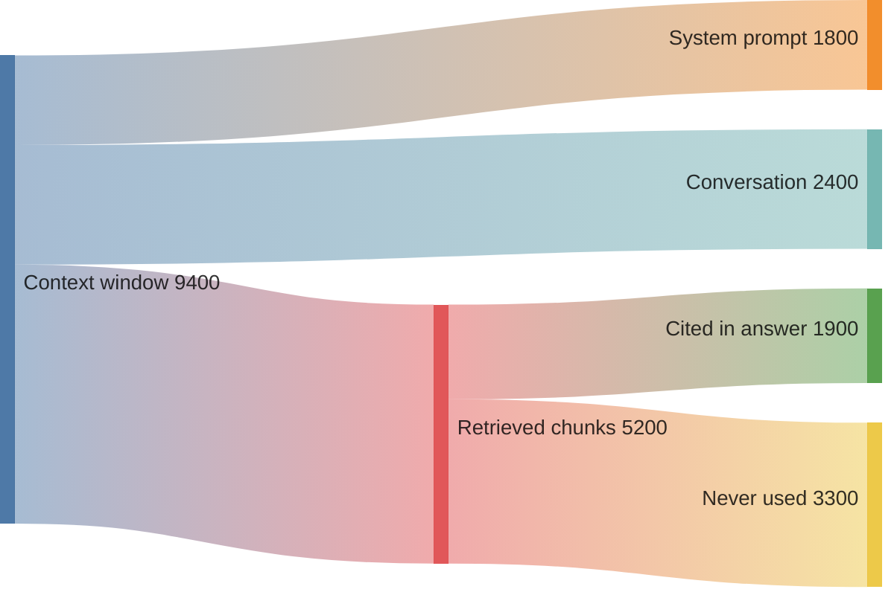

- CSV lines: `source,target,value`, no header, no spaces after commas.
- **It ignores the site theme** and paints its own palette. Use it when the flow is the point; keep it to two levels.
- Node names on the same column collide if they are long. Keep them under about 18 characters.

## packet-beta

**When:** the bit layout of a format or protocol: number formats in quantization posts, token IDs, headers.

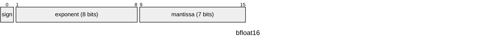

- Renders small. One row of 16 or 32 bits is the limit for the column.
- Compare formats with two diagrams one after the other (fp16, then bf16), not one wide one.

## radar-beta

**When:** two to four options compared on four to six axes. Retrievers, models, vector stores.

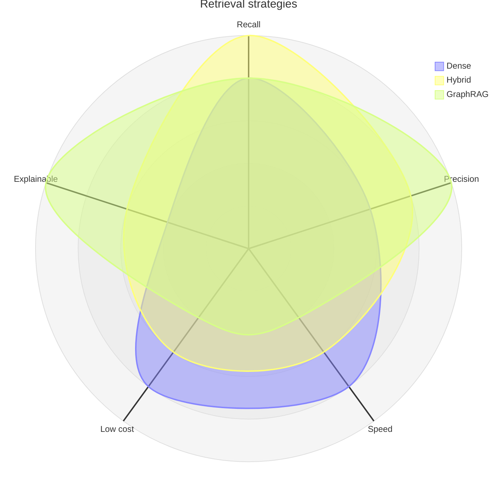

- Scores must be defensible. Say in the prose where each comes from (benchmark, experience, docs).
- Four curves at most (the series palette has four colours).

## treemap-beta

**When:** part of a whole, with hierarchy: where a model's parameters live, where a budget goes.

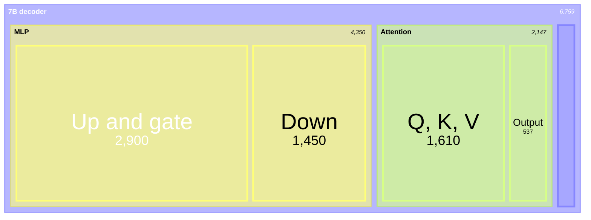

- Indentation is the hierarchy. Every leaf has a value; parents sum their children.
- Leaves under about 4 % of the total lose their label. Merge them into "Other".

## mindmap

**When:** the map at the top of a series or a long post: the territory and how the parts divide it. One per series, not per post.

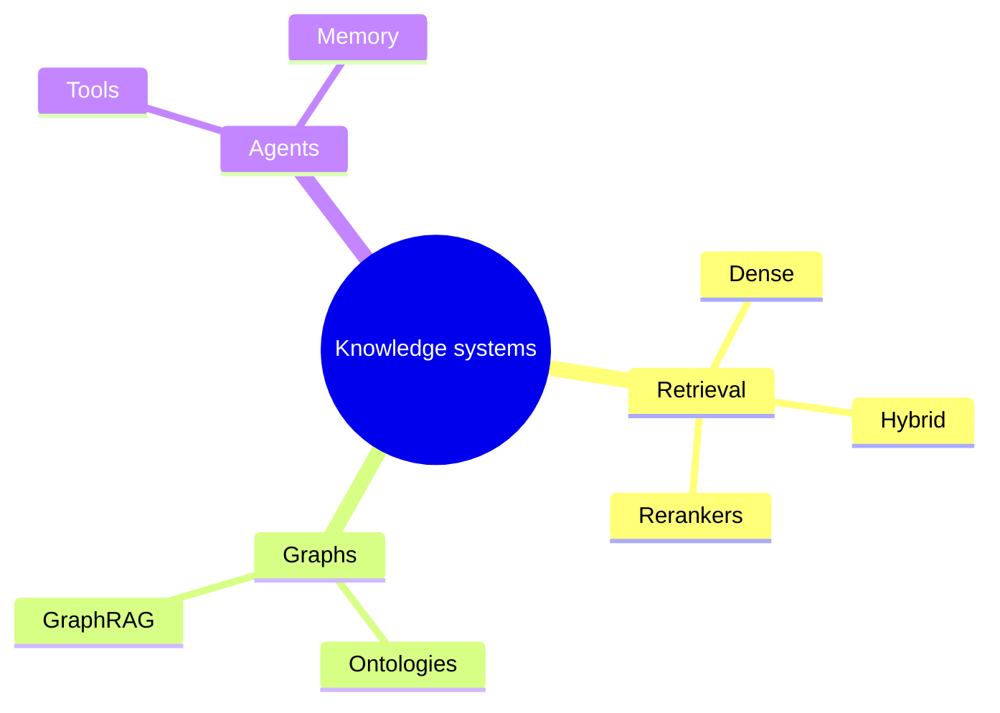

- Two levels below the root. A third level makes it a wall.
- Branch names match the post or series titles, so the map works as a table of contents.

## gitGraph

**When:** versioned things: experiment branches, prompt versions, data and model lineage.

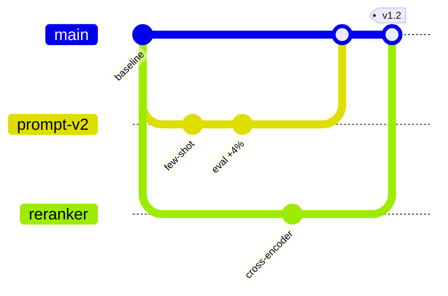

- Commit ids are the change, in two or three words. Tags mark releases.

## ishikawa-beta

**When:** root-cause posts: why an agent hallucinated, why a pipeline drifted. The effect on the right, causes grouped by category.

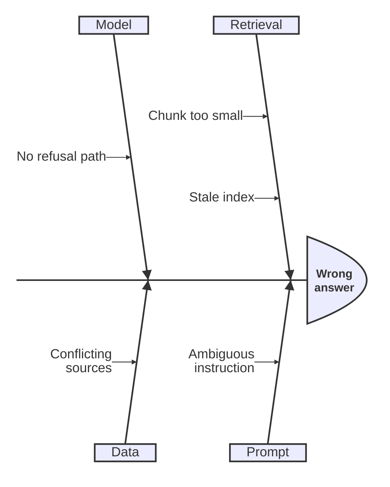

- Indentation: effect, then categories, then causes. Four to six categories.

## timeline

**When:** events over time, where the order is the point.

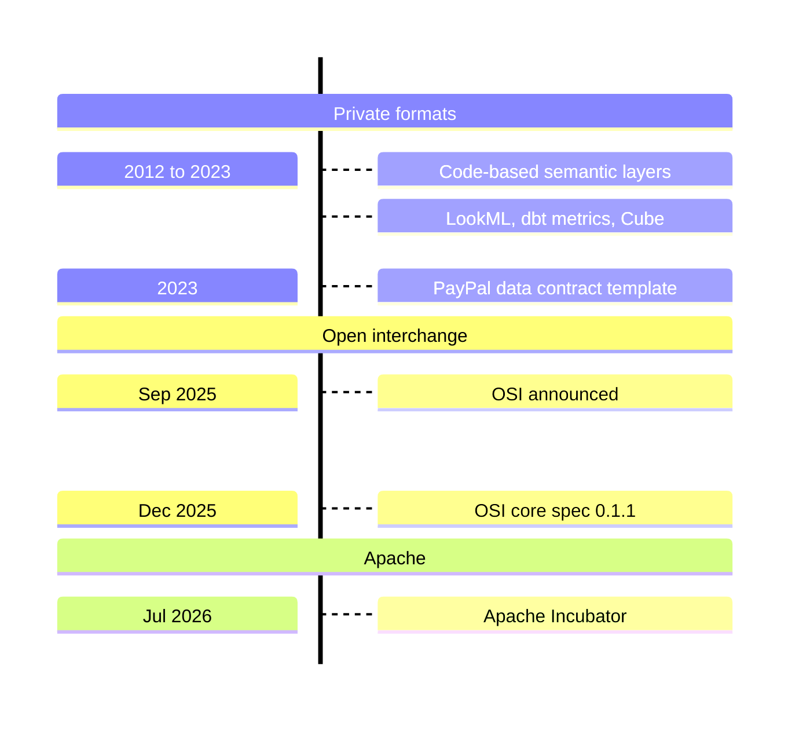

- **Always `timeline TD`.** The default horizontal timeline gives each period a column: four periods already render at 71 % (10 px labels), seven at 47 % (the Ossie post). Vertical renders at full size at any length. Verified.
- Group periods with `section`; the section bands become the chapters of the story.
- Each event is a few words. Detail goes in the prose after the diagram.
- Dates follow the post's own claims; never invent a year (see the dates rule in the blog style guide).

## erDiagram

**When:** tables and their relationships.

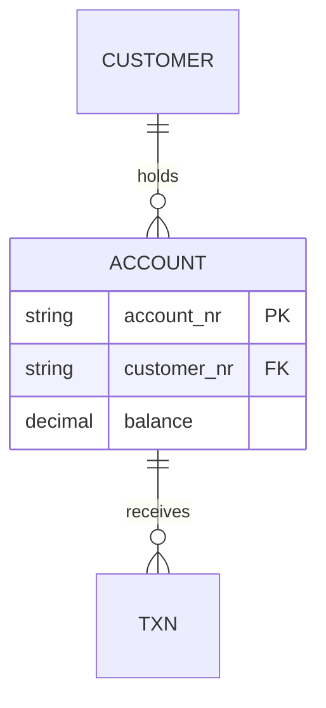

- **Reserved words break the parser** as entity names: `CLASS`, `END`, `STYLE` and similar. Verified: `FILE ||--o{ CLASS` fails. Rename the entity (`CODE_CLASS`).
- Show only the columns the paragraph discusses.

## xychart-beta

**When:** a measured series over an axis. Training curves, benchmarks.

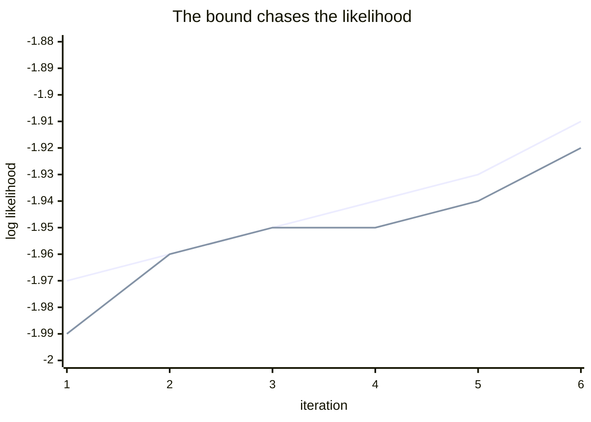

- **No legend.** Name each series, in order and by colour, in the sentence before the chart ("cyan is the likelihood, rose is the bound").
- At most four series. Real data only.
- This renderer is the weakest of the set. Phase 5 of the diagram plan replaces it with a real charting block; until then keep charts simple.

## quadrantChart

**When:** only when both coordinates are measured or scored on a stated scale. A quadrant with invented positions looks like data and is not; use a table or a list instead.

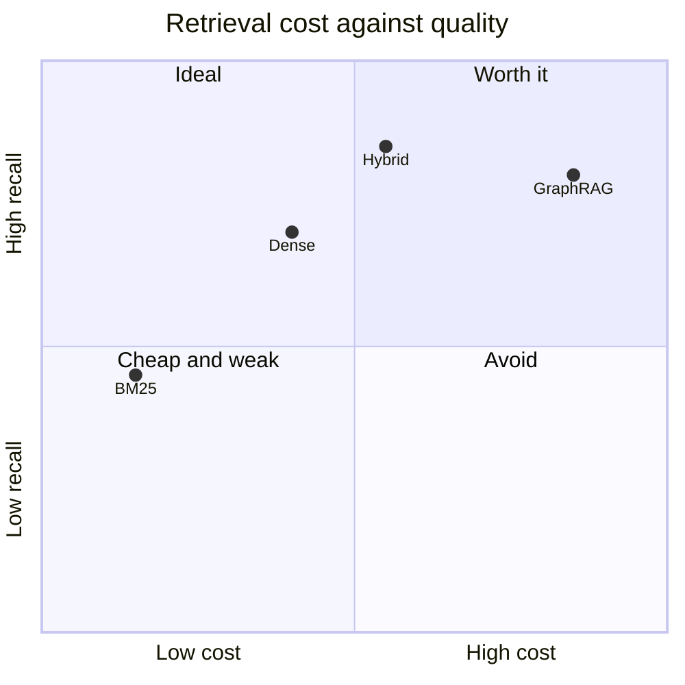

- Points are `Name: [x, y]` with brackets, values in 0 to 1. No parentheses or colons in names. Verified: `Name: 0.2, 0.3` without brackets fails.
- `quadrant-1` is the top right and is the one the theme highlights. Put the desirable region there.

## journey and kanban

Both render, and both are rarely the best choice. `journey` comes out small, with emoji faces; use it only for adoption stories with five or six steps. `kanban` is a list with columns; a table usually says the same thing more clearly.
