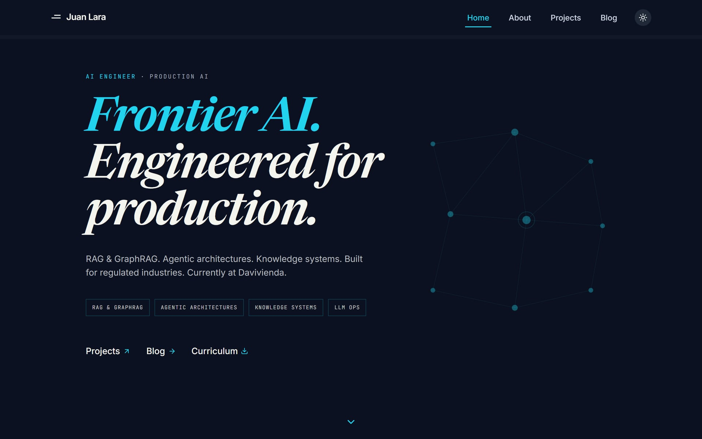
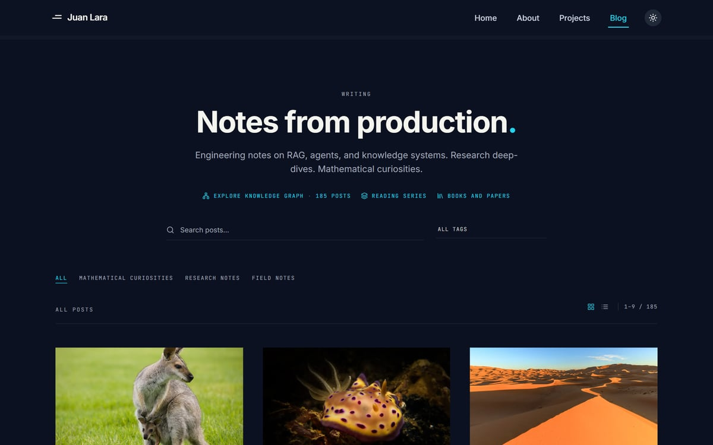
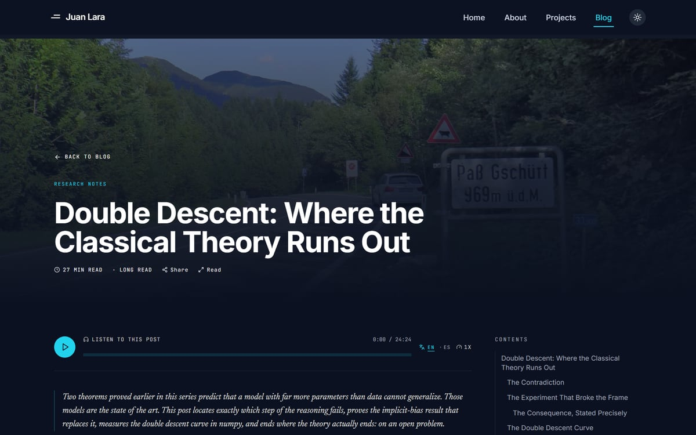
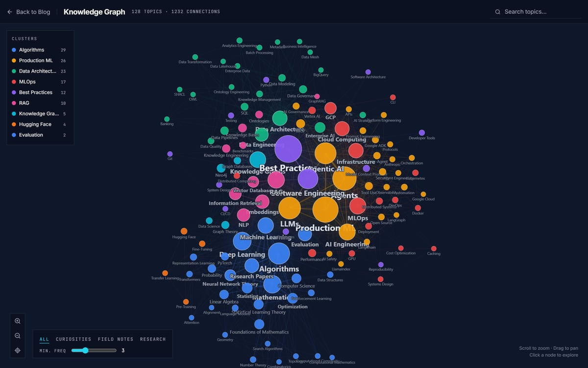
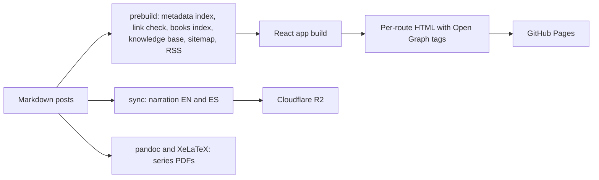

<div align="center">

# Juan Lara

**AI Engineer.** Frontier AI. Engineered for production.

[](https://juanlara18.github.io/portfolio/)
[](https://github.com/JuanLara18/portfolio/actions/workflows/deploy.yml)
[](LICENSE)

[Website](https://juanlara18.github.io/portfolio/) · [Blog](https://juanlara18.github.io/portfolio/blog/) · [LinkedIn](https://www.linkedin.com/in/julara/) · [RSS](https://juanlara18.github.io/portfolio/rss.xml)

<br/>



</div>

<br/>

The source of my personal site and technical blog. I build production AI at enterprise scale: retrieval platforms from RAG to GraphRAG, agentic architectures, and the knowledge systems that ground them. The blog is where I work through that engineering in public.

## The blog

180+ long-form posts in three lanes, with narration in English and Spanish.

| Lane | What it covers |
|---|---|
| **Field Notes** | Production AI in practice. RAG, agents, knowledge graphs, data platforms, MLOps on GCP. |
| **Research Notes** | Close readings of the papers and theorems behind modern ML, each tied back to what it means for shipping. |
| **Mathematical Curiosities** | Results that break intuition. Number theory, graph theory, complexity. |

Posts are organized for reading, not just browsing.

- **Reading series.** 20+ curated arcs, such as *Machine Learning from First Principles* and *Why Learning Works*.
- **Print editions.** Series and reading paths compile into print-ready PDFs in four page layouts.
- **Topic graph.** An interactive map of every topic and the posts that connect them.
- **Books and papers.** Every work cited across the blog, ranked by how many posts rely on it.
- **Narration.** Listen to a post instead of reading it, in English or in Spanish.

<table>
  <tr>
    <td width="33%"></td>
    <td width="33%"></td>
    <td width="33%"></td>
  </tr>
  <tr>
    <td align="center"><sub>Blog index</sub></td>
    <td align="center"><sub>Post with narration</sub></td>
    <td align="center"><sub>Topic graph</sub></td>
  </tr>
</table>

## How it is built

A static React app on GitHub Pages, fed by a content pipeline that turns Markdown into everything else.



A few decisions worth reading the code for:

- **Real URLs on a static host.** Every route ships its own HTML file, so crawlers get a 200 and each post gets its own social preview. Deep links survive GitHub Pages through a `404.html` round trip.
- **Small bundles.** The app carries post metadata only. A post's body is fetched as Markdown when it opens, and Mermaid loads when the first diagram scrolls into view. The home page ships about 180 KB of gzipped JavaScript.
- **Links that cannot rot.** Posts link to each other by slug. The build fails on a link to a post that does not exist, so broken references never deploy.
- **Narration cached by content.** Audio regenerates only when a post's prose changes. Edits to code, diagrams, or math keep the existing audio.
- **Readable by agents.** [`knowledge-base/`](knowledge-base/) indexes every post by concept, prerequisite, and technology, so an AI assistant can answer questions about the blog without reading 180 posts.

| Layer | Tools |
|---|---|
| App | React 18, React Router 6, Tailwind CSS, Framer Motion |
| Rendering | react-markdown, KaTeX, Mermaid, Prism |
| Content pipeline | Node.js build scripts, Python orchestrator |
| Narration | edge-tts, Ollama for Spanish translation, Cloudflare R2 |
| Print | pandoc, XeLaTeX |
| Delivery | GitHub Actions, GitHub Pages |

## Run it locally

```bash
git clone https://github.com/JuanLara18/portfolio.git
cd portfolio/front
npm install
npm start        # http://localhost:3000
npm run build    # full content pipeline plus production build
```

Requires Node.js 18 or later. The audio pipeline additionally needs Python 3.10+.

## Documentation

| Guide | For |
|---|---|
| [Architecture](docs/architecture.md) | How the app, routing, rendering, and SEO fit together |
| [Authoring](docs/authoring.md) | Writing a post: frontmatter, links, math, diagrams, series |
| [Operations](docs/operations.md) | Commands, CI/CD, audio hosting, troubleshooting |
| [Workflow](docs/workflow.md) | Branches, pull requests, versions and releases |
| [Knowledge base](docs/knowledge-base.md) | The agent-facing index of the blog |
| [Build scripts](front/scripts/README.md) | Reference for every script in the content pipeline |
| [Print PDFs](front/scripts/pdf/README.md) | Layout rules for the series PDF builder |

## License

[MIT](LICENSE). Header photographs are third-party works, credited in [`ATTRIBUTIONS.md`](front/public/blog/headers/ATTRIBUTIONS.md).

Contact: [larajuand@outlook.com](mailto:larajuand@outlook.com) or [LinkedIn](https://www.linkedin.com/in/julara/).
