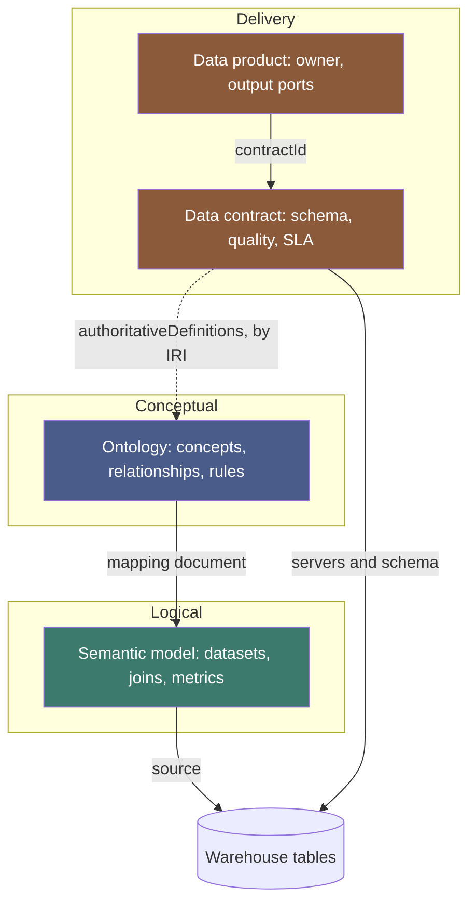
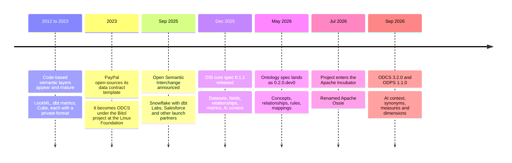
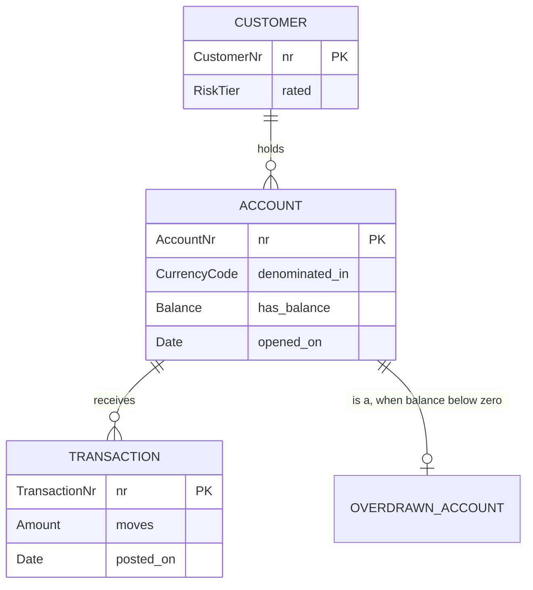
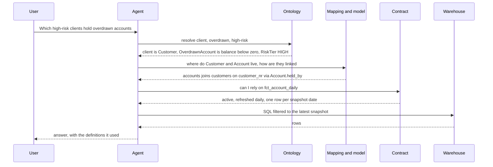

# Apache Ossie: Ontologies, Semantic Models, and Data Contracts as One Open Stack

Ask three systems in the same bank how much money customers hold in deposits and you will get three numbers. The BI dashboard says one thing, because its `Total Balance` measure sums the end-of-day ledger. The finance cube says another, because it converts everything to the reporting currency first. The agent the innovation team shipped last quarter says a third, because it found a column called `bal_amt_2`, guessed, and summed it across every daily snapshot in the table.

Nobody made an arithmetic mistake. All three computed exactly what they were told. The trouble is that what they were told lives in three places, in three formats, written by three teams, and none of the three can read the others. The dashboard's definition is locked inside a BI tool's model file. The cube's is in MDX. The agent's is in a prompt somebody wrote on a Tuesday.

This is the oldest problem in data, and it has acquired a new urgency. For twenty years an inconsistent definition cost you an awkward meeting. Now it costs you an agent that acts on the wrong number, at machine speed, with complete confidence. An LLM has no way of knowing that `cust_flg_2` means "customer has passed enhanced due diligence" unless something tells it, in a form it can read.

**Apache Ossie** is the industry's current answer to "what form?". It began as the Open Semantic Interchange, launched by Snowflake and a group of partners in September 2025, and entered the Apache Incubator under its new name in July 2026. It is a YAML and JSON specification with two layers: a *semantic model* that describes datasets, joins, and metrics, and an *ontology* that describes the business concepts those datasets are about. Next to it sit two Linux Foundation standards from the Bitol project, the Open Data Contract Standard and the Open Data Product Standard, which describe the data that is actually delivered and who answers for it.

Together those three are the closest thing we have to an open, end-to-end stack for meaning. This post is the complete tour. It assumes you work with data, that words like "semantic layer" and "ontology" have crossed your desk, and that you would like one place where all of it is laid out carefully: every term, the theory underneath, a worked example that actually validates, and a clear-eyed list of what is not solved yet.

A note on versions, because this field moves fast and the spec is not yet 1.0. Everything here is anchored to **Ossie core specification 0.1.1** (released) and **0.2.0.dev0** (in development, where the ontology lives), **ODCS 3.2.0**, and **ODPS 1.1.0**. Where the draft is likely to change, I say so.

## The Problem, Stated Precisely

"Semantics" is an overloaded word, so let's pin it down. A warehouse table tells you how data is *stored*. It does not tell you what the data *means*. Meaning is at least five separate things:

| Kind of meaning | The question it answers | Where it usually lives today |
|---|---|---|
| **Concepts** | What is a Customer? Is a prospect one? | A glossary page, a slide, someone's head |
| **Relationships** | Can an account have two holders? | Foreign keys, if you are lucky |
| **Rules** | Can a balance be negative? Must every account have a holder? | Application code, dbt tests, tribal knowledge |
| **Calculations** | How exactly is churn computed? | A BI tool's model file, per tool |
| **Guarantees** | Who owns this? How fresh is it? Can I rely on it? | A wiki, a Slack channel, nowhere |

Each row has had tools for years. Data catalogs hold glossaries. BI tools hold calculations. dbt holds tests. What has never existed is a shared *format*, so each tool keeps its own private copy. A mid-sized company with a warehouse, a transformation layer, two BI tools, a catalog, and an agent platform has the definition of "active customer" written down six times. They drift. They always drift.

The usual fix is to pick one tool and declare it the source of truth. That works until you add a second tool, or replace the first. Your definitions are an asset that outlives any vendor contract, and they are stored in the one format guaranteed not to survive the migration.

An open interchange format attacks this from the other side. It does not try to be the tool. It tries to be the file every tool can read and write. The repository's converter guide puts the arithmetic plainly: translating between N vendor formats point to point needs N×(N−1) converters, while a hub format needs 2N, one import and one export per vendor.

## A Vocabulary You Can Hold in Your Head

Half the confusion in this area is words. Different communities use the same word for different things and different words for the same thing. Here is the working glossary for the rest of the post. Skim it now, come back to it later.

| Term | Plain meaning | Also called |
|---|---|---|
| **Semantic layer** | A layer between the warehouse and its consumers that defines metrics and joins once | Metrics layer, headless BI |
| **Semantic model** | One file in that layer: datasets, fields, relationships, metrics | LookML model, semantic view, cube |
| **Dataset** | A logical table. Points at a physical table, view, or query | View, explore, entity |
| **Field** | A row-level attribute of a dataset, possibly computed | Dimension, attribute, column |
| **Dimension** | A field you group or filter by | Attribute |
| **Metric** | An aggregate calculation over fields | Measure, KPI |
| **Grain** | What one row of a dataset represents | Level of detail |
| **Ontology** | A formal description of concepts, their relationships, and the rules that hold | Conceptual model, domain model |
| **Concept** | A type of thing the business cares about | Class, entity, object type |
| **Entity type** | A concept whose instances are real-world things, referred to by an identifier | Entity, object type |
| **Value type** | A data type with business meaning attached | Domain, datatype |
| **Relationship** | A typed connection between concepts | Property, fact type, predicate |
| **Role** | The part a concept plays in a relationship | Argument, position |
| **Verbalization** | A sentence template that reads a relationship aloud | Reading, predicate reading |
| **Multiplicity** | How many of one side relate to the other | Cardinality, functional dependency |
| **Mapping** | A declaration of how fields populate concepts and relationships | Binding, lifting |
| **IRI** | A globally unique identifier for a concept, shaped like a URL | URI |
| **Data product** | A dataset someone owns and offers to others, with promises attached | |
| **Data contract** | The written promise: schema, quality, SLA, owner | |
| **Output port** | One place a data product can be consumed from | Interface |
| **Conceptual, logical, physical** | The classic three levels: what things *are*, how they are *structured*, where they are *stored* | |

The last row is the key to everything that follows. It is a distinction from 1970s database design, and it turns out to be exactly the right way to slice the modern stack.

## Three Layers, Three Questions

The stack answers three different questions, and it is worth being strict about which layer answers which.

- **Conceptual: what exists?** Customers, accounts, transactions. A customer holds accounts. Every account has exactly one currency. This is true whether the data lives in BigQuery, in a mainframe, or on paper. *This is the ontology.*
- **Logical: how do I compute with it?** There is a dataset `accounts` at grain one-row-per-account. It joins to `customers` on `customer_nr`. `total_balance` is `SUM(accounts.balance)`. *This is the semantic model.*
- **Delivery: what am I actually promised?** The table `fct_account_daily` is refreshed daily by 06:00, owned by the deposits data team, and `customer_nr` is never null. *This is the data contract.*

The diagram below shows the three layers and, more importantly, the arrows between them. The arrows are where the value is. A layer that does not point at its neighbours is just one more silo with nicer syntax.



Read it top to bottom and you get meaning descending toward storage. Read the dotted line and you get the loop closing: the contract on a physical table points back up at the concept that table is about.

| | Ontology | Semantic model | Data contract |
|---|---|---|---|
| Standard | Apache Ossie ontology | Apache Ossie core | Bitol ODCS, with ODPS for the product |
| Status at the versions used here | 0.2.0.dev0, draft | 0.1.1 released, 0.2.0 draft | 3.2.0 and 1.1.0, released |
| Unit of authorship | One business domain | One analytical model | One output port |
| Typical author | Domain expert with a modeler | Analytics engineer | Data product owner |
| Changes when | The business changes | The analysis changes | The pipeline changes |
| Knows about tables? | No | Yes, by name | Yes, in detail |

That last row matters. The ontology never mentions a table. That is the point of it.

## Where Ossie Came From

A short history helps, because it explains the shape of the spec.



Three things in that timeline deserve a comment.

**It started as a BI interchange format.** The 0.1.1 core spec is a dimensional model in YAML: facts, dimensions, joins, measures. Its launch partners were warehouse and BI vendors, and the problem they wanted solved was "let my Tableau model and my Snowflake semantic view say the same thing."

**The ontology was added because agents needed more.** The working group that produced it is led by RelationalAI, and their public argument is short enough to quote: dimensional models support analytics and reporting, but agents need to reason. A star schema can tell an agent how to total revenue by region. It cannot tell it whether a "Tier-2 supplier" is a kind of supplier, or what follows when one goes offline. That requires concepts, identity, and rules.

**Apache governance is the substantive change in the rename.** The specification text did not change when OSI became Ossie; the name changed to stop colliding with the other famous OSI acronyms. What changed is who decides. Under the Apache Software Foundation, spec changes go through public mailing lists and a formal vote, and committer status is earned by contribution rather than assigned by employer. The announcement cites growth from 17 launch partners to more than 50 organizations, including Snowflake, Databricks, Salesforce, dbt Labs, Dremio, GoodData, RelationalAI, and Honeydew. Snowflake and Databricks agreeing on a metadata format is not an everyday event.

The project runs four working groups at the time of writing: metric language and relationships, catalog, ontology, and a financial-services common semantics group. That last one is worth watching if you work in a bank.

## The Logical Layer: An Ossie Semantic Model

We will build the stack from the middle, because the semantic model is the released, stable part and the one most readers already half-know. Our running example is the deposits domain of a retail bank: customers, the accounts they hold, the transactions posted to those accounts.

A semantic model document has a deliberately small surface. Six ideas:

**Datasets** are logical tables. Each has a `name`, a `source` (the physical table, view, or query), an optional `primary_key`, and a list of `fields`.

**Fields** are row-level attributes. A field's `expression` is scalar SQL, so a field can be a plain column or something computed. Fields carry an optional portable `datatype` and an optional `dimension` block.

**Relationships** are foreign keys between datasets, declared as `from` (the many side), `to` (the one side), and positionally matched column lists.

**Metrics** are aggregate expressions defined at the model level, so one metric may reference several datasets.

**Dialects** let one field or metric carry several spellings of the same expression.

**`ai_context` and `custom_extensions`** are the two escape hatches: free-form hints for LLM consumers, and vendor-specific metadata in an opaque JSON string.

Here is the deposits model, trimmed to the parts that matter:

```yaml
# semantics/deposits.semantic_model.ossie.yaml
version: 0.2.0.dev0
name: deposits
description: Deposits analytics model for the Personal Bank.
ai_context:
  instructions: >
    Use total_balance for point-in-time balances. Never sum balances
    across currencies.
  synonyms:
    - "total_balance: deposits, book"
  examples:
    - "What is the total balance held by HIGH risk customers?"
    - "How many accounts are overdrawn today?"
datasets:
  - name: customers
    source: bank-prod.deposits.dim_customer
    primary_key: [customer_nr]
    fields:
      - name: customer_nr
        datatype: String
        expression:
          dialects: [{dialect: ANSI_SQL, expression: customer_nr}]
      - name: risk_tier
        datatype: String
        expression:
          dialects: [{dialect: ANSI_SQL, expression: risk_tier}]
  - name: accounts
    source: bank-prod.deposits.fct_account_daily
    primary_key: [account_nr]
    fields:
      - name: account_nr
        datatype: String
        expression:
          dialects: [{dialect: ANSI_SQL, expression: account_nr}]
      - name: customer_nr
        datatype: String
        expression:
          dialects: [{dialect: ANSI_SQL, expression: customer_nr}]
      - name: currency
        datatype: String
        expression:
          dialects: [{dialect: ANSI_SQL, expression: currency_code}]
      - name: balance
        datatype: Decimal
        expression:
          dialects: [{dialect: ANSI_SQL, expression: ledger_balance}]
      - name: opened_on
        datatype: Date
        expression:
          dialects:
            - {dialect: ANSI_SQL, expression: CAST(opened_ts AS DATE)}
            - {dialect: BIGQUERY, expression: "DATE(opened_ts, 'America/Bogota')"}
relationships:
  - name: accounts_to_customers
    from: accounts
    to: customers
    from_columns: [customer_nr]
    to_columns: [customer_nr]
metrics:
  - name: total_balance
    description: Sum of ledger balances at the snapshot date.
    datatype: Decimal
    expression:
      dialects: [{dialect: ANSI_SQL, expression: SUM(accounts.balance)}]
  - name: overdrawn_accounts
    description: Number of accounts with a negative ledger balance.
    datatype: Integer
    expression:
      dialects:
        - dialect: ANSI_SQL
          expression: COUNT(DISTINCT CASE WHEN accounts.balance < 0 THEN accounts.account_nr END)
```

The full file also declares a `transactions` dataset and its relationship to `accounts`; it is omitted here for length and used in the mapping below.

A few design decisions in this small file are worth understanding rather than just copying.

### Fields rename, and that is a feature

Look at `currency`. Its expression is `currency_code`. The semantic model has already begun translating from the warehouse's vocabulary toward the business's. Look at `opened_on`, which hides a timestamp-to-date conversion and a timezone decision behind a plain name. This is the humble everyday work of a semantic layer: the consumer says `opened_on` and never needs to know that the correct answer involves `'America/Bogota'`.

### Dialects are honest about portability

A naive standard would say "write ANSI SQL and we will translate it." Anyone who has tried to port a date function between two warehouses knows how that ends. Ossie instead lets each expression carry several spellings and asks each consumer to pick its own, falling back to `ANSI_SQL`.

The 0.1.1 dialect list is ANSI SQL, Snowflake, Databricks, Tableau, and MDX. The 0.2.0 draft adds BigQuery, DAX, MAQL, Sigma, ThoughtSpot, Holistics AQL, and one more that matters more than the rest: `OSSIE_SQL_2026`. This is Ossie's own portable expression language, a carefully chosen subset based on ANSI SQL:2003 Core, with each function marked as required, recommended, or experimental.

The draft is unusually candid about the status of the others. `OSSIE_SQL_2026` is the only dialect whose semantics the specification defines. Every other dialect is *opaque*: Ossie stores the string and promises nothing about what it means. Registering DAX as a dialect lets you put a DAX expression in the file. It does not mean anything can translate it.

### Type and role are separate questions

A field can declare a `datatype` (one of `String`, `Integer`, `Decimal`, `Float`, `Boolean`, `Date`, `Time`, `DateTime`, `DateTimeTz`, `Opaque`) and, independently, `dimension.is_time`. These answer different questions. `datatype` says what kind of values the field holds. `is_time` says whether to treat it as a time axis.

They come apart more often than you would think. A fiscal-year column is an `Integer` that is absolutely a time dimension. An audit timestamp `created_at` is a `DateTime` that you never want on a chart's x-axis. The default is sensible, temporal types are time dimensions unless you say otherwise, and an explicit `is_time` always wins.

### What the semantic model does not say

Notice what is missing. Nothing in this file says a customer is a legal person. Nothing says an account must have a holder, or that `accounts.customer_nr` and `customers.customer_nr` refer to the same real-world thing rather than merely having equal values. The relationship is a join recipe. It tells you *how* to connect two tables, not *what the connection means*.

For a dashboard that is enough. For an agent asked "which of our high-risk clients hold overdrawn accounts?" it is not, because "client" and "overdrawn" appear nowhere. That gap is what the second layer fills.

## The Conceptual Layer: An Ossie Ontology

An ontology, in the sense Ossie uses the word, is a conceptual model of the business written in three kinds of statement: **concepts**, **relationships**, and **rules**. It never mentions a table.

### Concepts: entity types and value types

Every concept is one of two kinds, and this distinction does a lot of quiet work.

An **entity type** stands for real-world things that you cannot write down directly. You cannot put a customer in a cell. You can only *refer* to one, by a customer number, a tax ID, an email. `Customer`, `Account`, `Transaction` are entity types.

A **value type** is a data type with meaning attached. `CustomerNr` is a string, but it is not *just* a string; it is a string that identifies customers. `Amount` is a decimal that must be positive. Value types extend the built-in ones (`String`, `Integer`, `Decimal`, `Float`, `Boolean`, `Date`, `DateTime`).

If you have only ever modeled in SQL, value types look like ceremony. They earn their keep the first time someone joins `customer_nr` to `account_nr` because both are `VARCHAR(12)`. At the conceptual level those two columns have different types, and a tool that reads the ontology can refuse the join.

### Relationships: roles, arity, and sentences

A relationship connects concepts. Ossie groups each relationship under the concept that plays its first role, so `held_by` declared under `Account` gets the full name `Account.held_by`. That dot is deliberate: it lets rule expressions navigate the model the way object-oriented code navigates fields.

Three properties make Ossie relationships richer than foreign keys.

**They have any arity.** A relationship can be unary (`Account.is_frozen`, a fact about one thing), binary (`Account.held_by` a `Customer`), or ternary and beyond (`Person.purchased_on`, linking a person, a vehicle, and a date). Each position is a **role**. When one concept plays two roles in the same relationship, the second gets a name, as in `Store.ships_to_in_days` with a `Store` role named `destination`.

**They carry multiplicity.** `ManyToOne` says the last role is functionally determined by the others: each account is held by at most one customer. `OneToOne` says that holds in both directions, which is what makes a relationship usable as an identifier.

**They must be verbalized.** Every relationship has at least one `verbalizes` pattern, a sentence template with the roles in braces: `"{Account} is held by {Customer}"`. This is a required field, not documentation. It is what lets a domain expert read the model aloud and say "no, that is wrong," and it is what lets a tool hand an LLM a list of true sentences instead of a schema diagram.

### Identity: how you point at a thing

Because entities cannot be written down, each entity type declares how it is referenced. `identify_by: [nr]` on `Account` says: the `Account.nr` relationship, which links an account one-to-one to an `AccountNr`, is the preferred way to refer to an account.

Identifiers can be compound. An order line is identified by its line number *and* the order it belongs to. And since the order is itself an entity, identifying a line item means first identifying its order, which is why mappings for compound identifiers are nested. We will see that shape in a moment.

### Rules: `requires` and `derived_by`

Rules are where an ontology stops being a diagram and starts being checkable. Ossie has two kinds.

`requires` declares conditions that must always hold. On a value type: `Amount > 0`. On a concept, naming a relationship makes that role mandatory: `requires: ["Account.held_by"]` says every account has a holder. On a relationship: any item with sales in a store must be offered in that store.

`derived_by` defines a concept or relationship in terms of others, exactly like a view. `OverdrawnAccount` is derived from `Account` by `Account.has_balance < 0`. Nobody stores overdrawn accounts. The definition *is* the population. Derivations may be recursive: the spec's own example defines `ancestor_of` with a base case and a recursive case over `parent_of`.

### The deposits ontology

Here it is in full. Read the `verbalizes` lines as you go; they are the model in plain language.

```yaml
# semantics/deposits.ontology.ossie.yaml
version: 0.2.0.dev0
name: Deposits
description: Business concepts of the Personal Bank deposits domain.
ai_context:
  instructions: >
    Balances and amounts are in the account currency, never converted.
    A customer is the legal holder of an account, not the person who
    transacts on it.
  synonyms:
    - "Customer: client, holder, account holder"
    - "Account: deposit account, savings account"
prefixes:
  bnk: http://bank.example.com/ontology/banking#
ontology:
  - concept: CustomerNr
    type: ValueType
    extends: [String]
  - concept: AccountNr
    type: ValueType
    extends: [String]
  - concept: CurrencyCode
    description: ISO 4217 alphabetic code.
    type: ValueType
    extends: [String]
  - concept: RiskTier
    type: ValueType
    extends: [String]
    requires: ["RiskTier == 'LOW' OR RiskTier == 'MEDIUM' OR RiskTier == 'HIGH'"]
  - concept: Balance
    description: Signed ledger balance. Negative means overdrawn.
    type: ValueType
    extends: [Decimal]
  - concept: Amount
    description: Unsigned size of a single money movement.
    type: ValueType
    extends: [Decimal]
    requires: ["Amount > 0"]

  - concept: Customer
    description: Natural or legal person holding a relationship with the bank.
    type: EntityType
    iri: bnk:Customer
    identify_by: [nr]
    relationships:
      - name: nr
        roles: [{concept: CustomerNr}]
        multiplicity: OneToOne
        verbalizes: ["{Customer} is identified by {CustomerNr}"]
      - name: rated
        roles: [{concept: RiskTier}]
        multiplicity: ManyToOne
        verbalizes: ["{Customer} is rated {RiskTier}"]

  - concept: Account
    description: Ledger of transactions under a product, owned by a customer.
    type: EntityType
    iri: bnk:Account
    identify_by: [nr]
    requires: ["Account.held_by", "Account.denominated_in"]
    relationships:
      - name: nr
        roles: [{concept: AccountNr}]
        multiplicity: OneToOne
        verbalizes: ["{Account} is identified by {AccountNr}"]
      - name: held_by
        iri: bnk:ownedBy
        roles: [{concept: Customer}]
        multiplicity: ManyToOne
        verbalizes:
          - "{Account} is held by {Customer}"
          - "{Customer} holds {Account}"
      - name: denominated_in
        roles: [{concept: CurrencyCode}]
        multiplicity: ManyToOne
        verbalizes: ["{Account} is denominated in {CurrencyCode}"]
      - name: has_balance
        roles: [{concept: Balance}]
        multiplicity: ManyToOne
        verbalizes: ["{Account} has ledger balance {Balance}"]
      - name: opened_on
        roles: [{concept: Date}]
        multiplicity: ManyToOne
        verbalizes: ["{Account} was opened on {Date}"]

  - concept: OverdrawnAccount
    description: An account whose ledger balance is below zero.
    type: EntityType
    extends: [Account]
    derived_by: ["Account.has_balance < 0"]
```

The full file adds a `TransactionNr` value type and a `Transaction` entity with `posted_to`, `moves`, and `posted_on`, in the same pattern. That brings it to eleven concepts.

Two modeling decisions in there are worth noticing. `Balance` and `Amount` are both decimals, but they are different value types with different rules: an amount is always positive, a balance may be negative. The semantic model flattened both to `Decimal`. The ontology kept them apart. And `OverdrawnAccount` answers the agent question from earlier: "overdrawn" now has one definition, written once, that every consumer can read.

The picture below shows the entity types only. Value types are the attributes; relationships between entities are the lines.



### Global identifiers: the bridge to the rest of the world

Concept names are local to one ontology file. To say "my `Account` is the same thing as the one in that other vocabulary," a concept or relationship can carry an optional `iri`, either a full IRI or a `prefix:local` shorthand resolved against the top-level `prefixes` map.

The spec is precise about what this does and does not do. An IRI does not change how anything is referenced inside the file; expressions and mappings keep using local names. It exists so that tools can translate to IRI-based languages, and so that two ontologies can state that they mean the same externally defined thing. In our example, `bnk:Account` points at a class in an OWL ontology the bank already maintains. That single line is how an existing RDF investment and a new Ossie file get to coexist. It is also the hook the data contract will use.

## Which Kind of Ontology Is This? A Short Theory Detour

If you have worked with RDF, OWL, and SHACL, the Ossie ontology will feel familiar and slightly off, like a cousin's handwriting. That reaction is correct, and understanding why will save you from a category error.

There are, roughly, three traditions of writing down what a domain means.

**The description-logic tradition** gives us OWL. A class is a set, a property is a binary relation, and axioms let a reasoner *infer* new facts. Its defining assumption is the **open world**: anything not stated is unknown, not false. If the ontology says every account has a holder and your data has an account without one, an OWL reasoner does not report an error. It concludes that a holder exists and you have not told it who.

**The fact-based tradition** gives us Object-Role Modeling, developed by Terry Halpin and others from the 1970s NIAM method. Its primitives are entity types, value types, roles, n-ary fact types, reference schemes, and constraints, and its signature practice is *verbalization*: every fact type must be readable as a natural-language sentence that a domain expert can confirm or reject. Its assumption is the **closed world** of databases: what is not recorded is false, and a missing mandatory role is a violation.

**The property-graph tradition** gives us labeled nodes and typed edges with properties, usually with a light or implicit schema.

Now reread the previous section. Entity types and value types. Roles. Relationships of any arity, including unary ones. `identify_by` as a preferred reference scheme. Required verbalizations. Mandatory roles as constraints. My reading is that the Ossie ontology draws most directly on the fact-based tradition. The spec does not use the name; the expression-language proposal places the ontology layer closest to OWL, RelationalAI's Rel, and Goldman Sachs' Legend. But the vocabulary is recognisably Halpin's, and the working group's lead comes from a company built on relational knowledge graphs.

The practical consequences are concrete:

| | OWL with SHACL | Ossie ontology | Property graph schema |
|---|---|---|---|
| World assumption | Open, with SHACL adding closed checks | Closed, like a database | Closed |
| Relationship arity | Binary only, n-ary by reification | Any arity, natively | Binary, with edge properties |
| Missing mandatory value | Inferred to exist (OWL) or a violation (SHACL) | A violation | Depends on the engine |
| Derived concepts | Class axioms, limited rules | `derived_by`, including recursion | Queries, outside the schema |
| Identity | Global IRIs, no unique-name assumption | Local names, declared identifiers, optional IRIs | Internal IDs, optional keys |
| Bound to data by | A separate mapping language such as R2RML | Mapping documents in the same standard | The graph is the data |
| Natural home | Data integration, linked data, inference | Analytics, warehouses, agents over SQL | Traversal and graph analytics |

None of these is better. They are built for different jobs. If you need a reasoner to classify instances across loosely connected sources, you want OWL. If you need a business-readable model that sits on top of a warehouse and tells an agent which join is meaningful, the fact-based shape fits better, because it shares the database's assumptions.

The one caution: **the rule expression language for the ontology layer is not yet formally specified.** The portable `OSSIE_SQL_2026` language is scoped explicitly to the logical layer, and the proposal defers the ontology layer to a separate document. Expressions like `Account.has_balance < 0` are well-formed by example, not by grammar. Treat `requires` and `derived_by` today as precise documentation that tools will increasingly execute, not as something every implementation evaluates identically.

## The Mapping: Where Concepts Meet Columns

We now have a conceptual model that knows nothing about tables and a logical model that knows nothing about meaning. The **mapping document** connects them. It is a third file that references exactly one ontology and exactly one semantic model, and says how the fields of the second populate the concepts and relationships of the first.

A mapping has two kinds of statement.

An **object mapping** says how to find the *instances* of a concept. For an entity with a simple identifier this is one expression: the values of `accounts.account_nr` are account numbers, and through `Account.nr` each one denotes an `Account`.

A **link mapping** says how to find the *links* of a relationship. Link mappings are trees. The root identifies the first role, each child adds the next role, and a node that names a `relationship` declares that the tuple built so far is a link of it. The tree shape avoids repeating yourself when one row populates many relationships about the same entity, which is the normal case.

```yaml
# semantics/deposits.mapping.ossie.yaml
version: 0.2.0.dev0
name: deposits_mapping
description: Populates the Deposits ontology from the deposits semantic model.
ontology_ref:
  name: Deposits
  iri: ./deposits.ontology.ossie.yaml
semantic_model_ref:
  name: deposits
  iri: ./deposits.semantic_model.ossie.yaml
concept_mappings:
  - concept: Customer
    object_mappings:
      - expression: customers.customer_nr
    link_mappings:
      - object_mapping:
          expression: customers.customer_nr
        children:
          - relationship: rated
            object_mapping:
              concept: RiskTier
              expression: customers.risk_tier
  - concept: Account
    object_mappings:
      - expression: accounts.account_nr
    link_mappings:
      - object_mapping:
          expression: accounts.account_nr
        children:
          - relationship: held_by
            object_mapping:
              concept: Customer
              expression: accounts.customer_nr
          - relationship: denominated_in
            object_mapping:
              concept: CurrencyCode
              expression: accounts.currency
          - relationship: has_balance
            object_mapping:
              concept: Balance
              expression: accounts.balance
```

The full file also maps `Account.opened_on` and has a `Transaction` block of the same shape. Read the `Account` block as a sentence: *every row of `accounts` denotes an Account, identified by `account_nr`; it is held by the Customer whose number is `customer_nr`; it is denominated in `currency`; it has ledger balance `balance`.*

That sentence is the thing that was missing from the semantic model. The join `accounts_to_customers` said two columns are equal. The mapping says *why*: because the account is held by that customer. An agent that needs "accounts held by high-risk customers" can now walk `Account.held_by` then `Customer.rated`, find both mapped, and derive the join from the mapping instead of guessing it from column names.

One more consequence is easy to miss. `OverdrawnAccount` has no mapping, and needs none. It is derived. Once `Account.has_balance` is mapped, the definition `Account.has_balance < 0` fully determines which accounts are overdrawn. You map the base facts; the rules give you everything built on them.

Standalone mapping documents are new in the 0.2.0 draft. Earlier snapshots embedded the mapping, with a complete copy of the semantic model, inside the ontology file under `ontology_mappings`. That form is deprecated but still accepted, and the spec notes that parser and converter support for standalone documents is still catching up. If a tool rejects your mapping file, this is the first thing to check.

## The Delivery Layer: Data Products and Data Contracts

Ossie describes what data means. It says nothing about whether the data showed up this morning. That is a different kind of statement, a *promise* rather than a *definition*, and it has its own standards.

Both come from **Bitol**, a project of the Linux Foundation's LF AI and Data Foundation.

The **Open Data Contract Standard (ODCS)** describes one agreement between a producer and its consumers. A contract has fundamentals (id, version, status, domain), the servers where the data can be read, a schema with logical and physical types, quality rules, service-level properties, and the team responsible.

The **Open Data Product Standard (ODPS)** describes the product: its identity, owner, and status, plus input ports and output ports. Each output port points at a contract by `contractId`. A product is the thing a team owns; a contract is what one of its interfaces promises.

Here is the contract for the accounts table.

```yaml
# semantics/accounts.odcs.yaml
apiVersion: v3.2.0
kind: DataContract
id: deposits-accounts
name: Deposit Accounts
version: 2.1.0
status: active
domain: personal-bank.deposits
description:
  purpose: Daily snapshot of every deposit account, for analytics and agents.
  limitations: Balances are end-of-day ledger balances, not available balances.
context:
  instructions: >
    One row per account per snapshot date. Filter on the snapshot date
    before aggregating, or balances are counted once per day.
  constraints:
    - constraint: Do not convert or add balances across currencies.
servers:
  - server: production
    environment: prod
    type: bigquery
    project: bank-prod
    dataset: deposits
schema:
  - name: fct_account_daily
    physicalName: fct_account_daily
    logicalType: object
    authoritativeDefinitions:
      - type: ontology
        url: http://bank.example.com/ontology/banking#Account
    properties:
      - name: account_nr
        logicalType: string
        primaryKey: true
        primaryKeyPosition: 1
        required: true
      - name: customer_nr
        logicalType: string
        required: true
        authoritativeDefinitions:
          - type: ontology
            url: http://bank.example.com/ontology/banking#ownedBy
      - name: currency_code
        logicalType: string
        required: true
        semanticType: dimension
      - name: ledger_balance
        logicalType: number
        required: true
    quality:
      - type: sql
        description: Every account has a holder. Enforces ontology rule Account.held_by.
        query: SELECT COUNT(*) FROM ${object} WHERE customer_nr IS NULL
        mustBe: 0
slaProperties:
  - property: frequency
    value: 1
    unit: d
    driver: regulatory
  - property: latency
    value: 6
    unit: h
team:
  name: team-deposits-data
  members:
    - username: deposits-data@bank.example.com
      role: owner
```

And the product that offers it:

```yaml
# semantics/accounts.odps.yaml
apiVersion: v1.1.0
kind: DataProduct
id: deposits-accounts-product
name: Deposit Accounts
version: 2.1.0
status: active
domain: personal-bank.deposits
outputPorts:
  - name: bigquery-daily
    version: 2.1.0
    contractId: deposits-accounts
team:
  name: team-deposits-data
```

Three lines in the contract are doing the cross-layer work.

**`authoritativeDefinitions` closes the loop.** The table points at `banking#Account` and the `customer_nr` column points at `banking#ownedBy`. Those are the same IRIs the ontology declared with `iri: bnk:Account` and `iri: bnk:ownedBy`. A catalog can now answer "which physical tables hold Accounts?" by matching strings, with no inference required.

**The quality rule enforces an ontology rule.** The ontology says `requires: ["Account.held_by"]`. That is a statement about the business. The contract's SQL check, `customer_nr IS NULL` must be zero, is the same statement turned into something that runs every night against real rows. This pairing is the single most valuable habit in the whole stack: *every `requires` in the ontology should have a quality check in some contract*. The rule says what must be true; the check tells you when it is not.

**`semanticType` and `context` are the 3.2.0 additions.** ODCS 3.2.0 lets a property declare itself a `column`, `measure`, or `dimension`, and adds a `context` block with instructions, verified question-and-answer pairs, and negative constraints for AI consumers, along with first-class synonyms. Notice the overlap: Ossie has `ai_context`, ODCS has `context`. More on that tension below.

The reason to keep contracts as a separate layer, rather than cramming SLAs into the semantic model, is that they change for different reasons and belong to different people. The definition of an account changes when the business changes, perhaps once in years. The freshness of `fct_account_daily` changes when someone reschedules a job.

## Running It: From Files to a Working Gate

Enough reading. Let's make the five files do something. Everything in this section runs on a laptop.

### Prerequisites

| Requirement | Detail |
|---|---|
| Runtime | Python 3.11 or later |
| Packages | `pyyaml`, `jsonschema` 4.18 or later (which brings `referencing`) |
| Schemas | Five JSON Schema files, pinned into your repository |
| Hardware | None to speak of. No GPU, no warehouse, no network at validation time |
| Cost | Zero. Every tool and schema here is Apache 2.0 licensed |
| Licence and access | Public repositories, no account needed |

```bash
pip install "pyyaml>=6" "jsonschema>=4.18"
```

Lay the repository out like this. The schemas come from `apache/ossie` (`core-spec/ossie-schema.json`, `ontology/ontology.json`, `ontology/mapping.json`) and from `bitol-io` (`schema/odcs-json-schema-v3.2.0.json`, `schema/odps-json-schema-v1.1.0.json`). Copy them in and commit them. Do not fetch them at build time.

```
semantics-repo/
  schemas/
    ossie-schema.json
    ontology.json
    mapping.json
    odcs-json-schema-v3.2.0.json
    odps-json-schema-v1.1.0.json
  semantics/
    deposits.ontology.ossie.yaml
    deposits.semantic_model.ossie.yaml
    deposits.mapping.ossie.yaml
    accounts.odcs.yaml
    accounts.odps.yaml
  validate_semantics.py
  check_links.py
  render_context.py
```

### Gate 1: is every file well-formed?

All three standards publish JSON Schemas, so structural validation is twenty lines. The only subtlety is that `mapping.json` refers to the other two Ossie schemas by their raw GitHub URLs. We register the local copies under those URLs so validation never touches the network.

```python
"""validate_semantics.py: every semantic document is structurally valid."""
import json
import sys
from pathlib import Path

import yaml
from jsonschema import Draft202012Validator
from referencing import Registry, Resource

SCHEMAS = Path("schemas")
SEMANTICS = Path("semantics")

# The file-name suffix decides which pinned schema applies.
SCHEMA_FOR = {
    ".ontology.ossie.yaml": "ontology.json",
    ".semantic_model.ossie.yaml": "ossie-schema.json",
    ".mapping.ossie.yaml": "mapping.json",
    ".odcs.yaml": "odcs-json-schema-v3.2.0.json",
    ".odps.yaml": "odps-json-schema-v1.1.0.json",
}
RAW = "https://raw.githubusercontent.com/apache/ossie/main/"


def load_schemas() -> tuple[dict, Registry]:
    schemas = {p.name: json.loads(p.read_text("utf-8")) for p in SCHEMAS.glob("*.json")}
    # mapping.json points at the other two schemas by raw GitHub URL.
    # Serve the pinned local copies instead, so CI never touches the network
    # and a spec change upstream cannot break a build that changed nothing.
    registry = Registry().with_resources([
        (RAW + "ontology/ontology.json", Resource.from_contents(schemas["ontology.json"])),
        (RAW + "core-spec/ossie-schema.json", Resource.from_contents(schemas["ossie-schema.json"])),
    ])
    return schemas, registry


def main() -> int:
    schemas, registry = load_schemas()
    failed = 0
    for path in sorted(SEMANTICS.glob("*.yaml")):
        schema_name = next(v for k, v in SCHEMA_FOR.items() if path.name.endswith(k))
        validator = Draft202012Validator(schemas[schema_name], registry=registry)
        doc = yaml.safe_load(path.read_text("utf-8"))
        errors = sorted(validator.iter_errors(doc), key=lambda e: list(map(str, e.absolute_path)))
        print(f"{'FAIL' if errors else 'ok  '}  {path.name}  ({schema_name})")
        for err in errors:
            where = "/".join(str(p) for p in err.absolute_path) or "<root>"
            print(f"        {where}: {err.message[:160]}")
        failed += bool(errors)
    return 1 if failed else 0


if __name__ == "__main__":
    sys.exit(main())
```

Run against the five files of this post, it prints:

```
ok    accounts.odcs.yaml  (odcs-json-schema-v3.2.0.json)
ok    accounts.odps.yaml  (odps-json-schema-v1.1.0.json)
ok    deposits.mapping.ossie.yaml  (mapping.json)
ok    deposits.ontology.ossie.yaml  (ontology.json)
ok    deposits.semantic_model.ossie.yaml  (ossie-schema.json)
```

The Ossie repository also ships `validation/validate.py`, which goes further for semantic models: unique names, relationship references that resolve, matching column counts, and SQL syntax via `sqlglot`. Use it when you can. The script above exists because it covers all five document types in one pass and has no dependency on the repository layout.

### Gate 2: do the layers actually point at each other?

Schema validation proves each file is well-formed in isolation. It cannot tell you that the mapping references a field that was renamed last week, or that the contract links to an IRI nobody declared. Those cross-file checks are where real breakage hides, and today you have to write them yourself.

```python
"""check_links.py: the three layers actually point at each other."""
import re
import sys
from pathlib import Path

import yaml

SEMANTICS = Path("semantics")


def load(name: str) -> dict:
    return yaml.safe_load((SEMANTICS / name).read_text("utf-8"))


def expand(qname: str, prefixes: dict[str, str]) -> str:
    """bnk:Account -> http://bank.example.com/ontology/banking#Account"""
    if "://" in qname:
        return qname
    prefix, local = qname.split(":", 1)
    return prefixes[prefix] + local


def walk_mapping(node, concept: str, out: list) -> None:
    """Collect every (concept, relationship, expression) the mapping declares."""
    if isinstance(node, dict):
        if "expression" in node:
            out.append((concept, node.get("relationship"), node["expression"]))
        for value in node.values():
            walk_mapping(value, concept, out)
    elif isinstance(node, list):
        for item in node:
            walk_mapping(item, concept, out)


def main() -> int:
    ontology = load("deposits.ontology.ossie.yaml")
    model = load("deposits.semantic_model.ossie.yaml")
    mapping = load("deposits.mapping.ossie.yaml")
    contract = load("accounts.odcs.yaml")
    problems: list[str] = []

    concepts = {c["concept"]: c for c in ontology["ontology"]}
    fields = {f"{d['name']}.{f['name']}" for d in model["datasets"] for f in d.get("fields", [])}
    prefixes = ontology.get("prefixes", {})

    # 1. The mapping names the documents it claims to connect.
    if mapping["ontology_ref"]["name"] != ontology["name"]:
        problems.append("mapping.ontology_ref.name does not match the ontology")
    if mapping["semantic_model_ref"]["name"] != model["name"]:
        problems.append("mapping.semantic_model_ref.name does not match the semantic model")

    # 2. Every mapped concept exists, and every expression resolves to a field.
    mapped_relationships: set[str] = set()
    for cm in mapping["concept_mappings"]:
        if cm["concept"] not in concepts:
            problems.append(f"mapping targets unknown concept {cm['concept']}")
            continue
        declared = {r["name"] for r in concepts[cm["concept"]].get("relationships", [])}
        found: list = []
        walk_mapping(cm, cm["concept"], found)
        for concept, _, expression in found:
            for ref in re.findall(r"\b[a-z_]+\.[a-z_]+\b", expression):
                if ref not in fields:
                    problems.append(f"{concept}: expression uses unknown field {ref}")
        for link in cm.get("link_mappings", []):
            for child in link.get("children", []):
                rel = child.get("relationship")
                if rel not in declared:
                    problems.append(f"{cm['concept']}: unknown relationship {rel}")
                mapped_relationships.add(f"{cm['concept']}.{rel}")

    # 3. Every mandatory role in the ontology is populated by the mapping.
    for name, concept in concepts.items():
        for rule in concept.get("requires", []):
            if re.fullmatch(rf"{name}\.\w+", rule) and rule not in mapped_relationships:
                problems.append(f"{rule} is required by the ontology but never mapped")

    # 4. Every ontology link in the contract resolves to a declared IRI.
    known_iris = set()
    for concept in concepts.values():
        for item in [concept, *concept.get("relationships", [])]:
            if "iri" in item:
                known_iris.add(expand(item["iri"], prefixes))
    for obj in contract["schema"]:
        for holder in [obj, *obj.get("properties", [])]:
            for definition in holder.get("authoritativeDefinitions", []):
                if definition["type"] == "ontology" and definition["url"] not in known_iris:
                    problems.append(f"{holder['name']}: {definition['url']} is not in the ontology")

    for problem in problems:
        print("FAIL ", problem)
    if not problems:
        print(f"ok    {len(concepts)} concepts, {len(mapped_relationships)} mapped relationships, "
              f"{len(known_iris)} IRIs, all links resolve")
    return 1 if problems else 0


if __name__ == "__main__":
    sys.exit(main())
```

On the clean files:

```
ok    11 concepts, 8 mapped relationships, 5 IRIs, all links resolve
```

Now break it the way a real change would. Delete the `held_by` child from the mapping and change one expression to the physical column name `accounts.ledger_balance` instead of the field name `accounts.balance`. Both edits still pass Gate 1, because both files are still perfectly well-formed. Gate 2 catches them:

```
FAIL  Account: expression uses unknown field accounts.ledger_balance
FAIL  Account.held_by is required by the ontology but never mapped
```

The second line is the interesting one. The ontology declared a business rule, that every account has a holder. The mapping stopped supplying the data for it. No amount of per-file validation would notice, and an agent relying on `Account.held_by` would silently find nothing.

### Using the result: compile it into agent context

Validation proves the files are consistent. The payoff is what you can generate from them. The simplest useful artifact is a context block for an agent: the ontology's sentences, where each concept lives, and the sanctioned metrics.

```python
"""render_context.py: compile the ontology into the context an agent reads."""
import re
from pathlib import Path

import yaml

SEMANTICS = Path("semantics")


def load(name: str) -> dict:
    return yaml.safe_load((SEMANTICS / name).read_text("utf-8"))


def sentence(pattern: str, multiplicity: str | None) -> str:
    """'{Account} is held by {Customer}' -> 'Each Account is held by at most one Customer.'"""
    roles = re.findall(r"\{(\w+)(?::\w+)?\}", pattern)
    text = re.sub(r"\{(\w+)(?::(\w+))?\}", lambda m: m.group(2) or m.group(1), pattern)
    if multiplicity in ("ManyToOne", "OneToOne") and len(roles) >= 2:
        last = roles[-1]
        text = "Each " + text.replace(f" {last}", f" at most one {last}", 1)
    return text + "."


def render(ontology: dict, model: dict, mapping: dict) -> str:
    source_of = {d["name"]: d["source"] for d in model["datasets"]}
    dataset_of = {
        cm["concept"]: cm["object_mappings"][0]["expression"].split(".")[0]
        for cm in mapping["concept_mappings"]
    }
    lines = [f"# {ontology['name']}: {ontology['description']}", ""]
    if isinstance(ontology.get("ai_context"), dict):
        lines += [" ".join(ontology["ai_context"]["instructions"].split()), ""]

    for concept in ontology["ontology"]:
        if concept["type"] != "EntityType":
            continue
        name = concept["concept"]
        where = source_of.get(dataset_of.get(name, ""), "derived, no table of its own")
        lines.append(f"## {name} ({where})")
        if concept.get("description"):
            lines.append(concept["description"])
        for rel in concept.get("relationships", []):
            # The first verbalization is the canonical reading; the rest are inverses.
            lines.append("- " + sentence(rel["verbalizes"][0], rel.get("multiplicity")))
        for rule in concept.get("requires", []):
            lines.append(f"- Always true: {rule}")
        for rule in concept.get("derived_by", []):
            lines.append(f"- Defined as: {rule}")
        lines.append("")

    lines.append("## Metrics (use these, never re-derive them)")
    for metric in model.get("metrics", []):
        lines.append(f"- {metric['name']}: {metric['description']}")
    return "\n".join(lines)


if __name__ == "__main__":
    print(render(
        load("deposits.ontology.ossie.yaml"),
        load("deposits.semantic_model.ossie.yaml"),
        load("deposits.mapping.ossie.yaml"),
    ))
```

The output, abridged:

```
# Deposits: Business concepts of the Personal Bank deposits domain.

Balances and amounts are in the account currency, never converted. A customer
is the legal holder of an account, not the person who transacts on it.

## Account (bank-prod.deposits.fct_account_daily)
Ledger of transactions under a product, owned by a customer.
- Each Account is identified by at most one AccountNr.
- Each Account is held by at most one Customer.
- Each Account is denominated in at most one CurrencyCode.
- Each Account has ledger balance at most one Balance.
- Always true: Account.held_by
- Always true: Account.denominated_in

## OverdrawnAccount (derived, no table of its own)
An account whose ledger balance is below zero.
- Defined as: Account.has_balance < 0

## Metrics (use these, never re-derive them)
- total_balance: Sum of ledger balances at the snapshot date.
- overdrawn_accounts: Number of accounts with a negative ledger balance.
```

That is a few hundred tokens. Compare it with what an agent does without it: list the tables, sample rows from each, read column names, guess at joins, run a query, read the error, try again. The claim that compact semantics save tokens is not marketing; it is the difference between reading a page and exploring a warehouse. The verbalizations make this nearly free, because the model was already written as sentences.

### Getting existing definitions in: the converters

Nobody starts from an empty repository. The Ossie repository ships reference converters in a hub-and-spoke layout, where each spoke imports from or exports to one vendor format. At the commit I worked from, the `converters/` directory has spokes for Snowflake, Databricks, dbt, Salesforce and Tableau, Microsoft Power BI and Fabric, Cube, GoodData, Sigma, ThoughtSpot, Omni, Hex, Holistics, Honeydew, WisdomAI, Apache Polaris, OrionBelt, and an ontology converter that reads Palantir ontology exports.

The dbt spoke is the one most teams will reach for first. It converts in both directions between Ossie and dbt's MetricFlow semantic manifest:

```bash
dbt parse                       # writes target/semantic_manifest.json
ossie-dbt msi-to-ossie -i target/semantic_manifest.json -o deposits.semantic_model.ossie.yaml
```

Each dbt semantic model becomes one Ossie dataset. Constructs with no Ossie equivalent, conversion metrics for instance, are dropped with a warning on stderr while the file is still written. Read those warnings. A converter that succeeds while quietly dropping a third of your metrics is the most dangerous kind of success.

### Where to run it

There is no infrastructure question here, which is itself worth saying. The whole workflow is text files, a Python interpreter, and a CI runner.

| Stage | Where | What runs |
|---|---|---|
| Authoring | Any editor | YAML, with the JSON Schemas wired in for autocomplete |
| Pull request | CI runner, no secrets | Gate 1 and Gate 2 above |
| Merge to main | CI runner | Converters export to each platform's native format |
| Nightly | Warehouse, with credentials | Contract quality checks against real data |

Start with Gate 1 on a single domain. It takes an afternoon and immediately gives every definition change a reviewable diff.

## How an Agent Actually Uses the Stack

Here is the end-to-end flow for the question from the opening, "which high-risk clients hold overdrawn accounts?". Follow which layer answers which step.



Every arrow on the left half is a lookup in a file, not a guess. The synonym "client" resolves through `ai_context`. "Overdrawn" resolves through `derived_by`. The join comes from the mapping. And the contract's `context.instructions` supplies the detail that would otherwise have produced the wrong number: this table has one row per account *per day*, so filter the snapshot first.

There is published evidence that this structure matters. Sequeda, Allemang, and Jacob benchmarked GPT-4 answering business questions over an enterprise SQL schema, with and without a knowledge-graph representation of that schema carrying ontology and mappings. Accuracy on their question set rose from roughly 16% with the bare SQL schema to roughly 54% with the knowledge graph, and the gap was widest on the questions that touched the most complex parts of the schema. One benchmark, one model generation, one insurance schema; do not generalise the exact numbers. The direction has held up well.

### Four situations where this pays for itself

**Grounding text-to-SQL.** The case above. The agent composes from named concepts and sanctioned metrics instead of inferring intent from column names.

**Running two BI tools, or migrating between them.** Metrics authored once in Ossie, exported to each tool by converter. The definitions stop being hostage to the tool that happens to hold them.

**Merging organisations or platforms.** Two warehouses each have a `customer` table that means something slightly different. Give both ontologies the same IRI where they agree and different ones where they do not. The disagreement becomes an explicit, reviewable fact instead of a surprise in a board report.

**Regulated reporting.** A regulator asks how a figure was computed. With the stack in Git, the answer is a commit: this metric, this definition of the underlying concept, this contract guaranteeing the source, each with an author and an approval.

## Gotchas

Things that will cost you an afternoon if nobody warns you.

- **The 0.1.1 and 0.2.0 document shapes are incompatible.** Released 0.1.1 wraps models in a `semantic_model` list. The 0.2.0 draft puts one model at the document root and rejects the wrapper. Many tutorials and tools still use the old shape. Check the `version` line before debugging anything else.
- **`0.2.0.dev0` is a moving target.** The spec says plainly not to depend on it in production. Pin the schema files in your own repository, as above, and upgrade deliberately.
- **Non-Ossie dialects are opaque strings.** Putting a `DAX` or `SNOWFLAKE` expression in a file means it is stored, not understood. Nothing guarantees your `ANSI_SQL` and `BIGQUERY` spellings of the same field agree. Test them against data.
- **Mapping expressions reference fields, not columns.** `accounts.balance` is the semantic model's field. `ledger_balance` is the warehouse column behind it. Mixing them up passes schema validation and fails at use, which is exactly what Gate 2 demonstrated.
- **Standalone mapping documents are ahead of the tooling.** The spec itself says parser and converter support is still coming. Some tools only accept the deprecated embedded form.
- **The command-line validator may be a stub.** At the commit I read, the Go CLI's `validate` command returned "not yet implemented". The Python `validation/validate.py` is the working validator.
- **Package names in READMEs may run ahead of releases.** I could not find the converter packages on PyPI under the names their READMEs give. Installing from a repository checkout with `uv sync` works.
- **The `authoritativeDefinitions` type string is a convention.** ODCS documents `ontology`, `glossary`, and `taxonomy` among its example types. The Data Contract CLI resolves the type `semantics` and passes `ontology` through untouched. Decide on one per organisation and write it down.
- **Converters are lossy by design.** Vendor features without an Ossie equivalent land in `custom_extensions` or are dropped with a warning. A round trip is not guaranteed to be the identity.

## What the Stack Still Leaves Out

I have been enthusiastic for several thousand words. Here is the other side, because adopting a pre-1.0 standard on enthusiasm alone is how people get hurt.

**There is no query interface.** Ossie describes models. It does not define how to *ask* one a question. The draft is explicit that declaring a model and querying it are separate, and that query interfaces belong to future documents. A standard semantic query language and a reference engine sit under "future efforts" on the roadmap. Until they exist, two tools reading the same file can still compile the same metric into different SQL, for instance by resolving a join path differently.

**The trust machinery is thin.** As one independent review of the spec noted, words like *lineage*, *freshness*, and *provenance* do not appear in the core specification. There is no field for who certified a metric or when it was last verified. Certification, stable identifiers, and governance hooks are open roadmap discussions. In practice this is why you need the contract layer, and why Ossie on its own is not a governance solution.

**Metric semantics are still basic.** A metric today is an aggregate expression. Grain as a first-class concept, semantic filters, cumulative and derived metrics, metric trees, explicit relationship cardinality, dimension hierarchies, and calendar handling are all active working-group topics. If your current layer leans on any of these, expect them to travel through `custom_extensions` for now.

**The ontology's rule language is not specified.** As discussed above. This is the largest gap between what the ontology layer promises and what a tool can verifiably execute today.

**The layers overlap, and people disagree about which is primary.** ODCS 3.2.0 has `context`, synonyms, and measure and dimension roles. Ossie has `ai_context`, synonyms, and metrics. Jean-Georges Perrin, one of the lead maintainers of the Bitol standards, has argued in print that the contract should be the authored source of truth and that Ossie is a lossy projection of it, since a projection to Ossie drops quality rules, SLAs, ownership, and access terms. The Ossie community would say the semantic model and ontology are primary and the contract describes one delivery of them. I do not think either is simply right. The workable rule is to give each fact exactly one home: *definitions* in Ossie, *promises* in the contract, and where a field appears in both, generate one from the other rather than typing it twice.

**It is still a vendor-initiated standard.** Apache governance is a real safeguard, and committer status earned by contribution is not a formality. But the launch partners are companies that sell semantic layers, and incubation is a status, not a graduation. Watch whether the contributor list broadens beyond vendors to the organisations that actually have the definitions problem.

**Native support lags the announcements.** Most integration today goes through the reference converters rather than through platforms reading Ossie files directly. That is a reasonable place for a young standard to be. It also means "supports Ossie" on a product page can mean very different things.

## How to Decide

You do not need all three layers at once, and most organisations should not start with all three.

| Your situation | Start with | Why |
|---|---|---|
| One BI tool, no agents, no plans to change | Nothing new | Your tool's native model is fine. Revisit when a second consumer appears |
| Metrics defined in two or more tools | Ossie semantic model, with converters | This is the problem the released spec was built for |
| Teams burned by silent upstream schema changes | ODCS contracts | Most mature layer, strongest tooling, fastest payback |
| Agents answering questions over a warehouse | Semantic model plus `ai_context`, then an ontology for the hard domain | Agents need concepts and rules, but start where the definitions already exist |
| An existing OWL or RDF ontology | Keep it. Add `iri` links from Ossie concepts | The IRI bridge exists precisely so you do not have to choose |
| A regulated domain with audit requirements | All three, one domain at a time | The audit trail is the cross-layer links |

Whatever the entry point, four practices hold:

1. **Semantics as code.** YAML in Git, changes by pull request, schemas pinned, validation in CI. A definition that cannot be diffed cannot be governed.
2. **One home per fact.** Definitions in the ontology and semantic model, promises in the contract. Generate, do not duplicate.
3. **Every rule gets a check.** Each `requires` in the ontology is matched by a quality rule in a contract.
4. **Domain experts own the meaning.** The format exists so that the person who knows what an account *is* can read the file and say whether it is right. Verbalizations are how you make that possible.

## Where to Go Next on This Blog

This post is designed to stand alone. Several of its sections compress topics that have longer treatments here, for when you want depth on one layer:

- The OWL, RDF, and SHACL tradition this post contrasts against: [Ontologies: The Blueprint Behind Every Knowledge Base That Actually Works](https://juanlara18.github.io/portfolio/#/blog/ontologies-building-knowledge-bases) and [TBox and ABox](https://juanlara18.github.io/portfolio/#/blog/tbox-abox-schema-facts-distinction).
- Ontology-as-code with a full CI pipeline, compiling YAML to OWL: [Ontologies in Production](https://juanlara18.github.io/portfolio/#/blog/ontology-production-pipeline-gcp).
- The semantic layer from the BI side, with LookML, MetricFlow, and Cube compared: [LookML: The Semantic Layer That Turns SQL Into a Product](https://juanlara18.github.io/portfolio/#/blog/lookml-semantic-layer-data-modeling).
- Product thinking and the contract as an artifact: [Knowledge as a Product](https://juanlara18.github.io/portfolio/#/blog/knowledge-as-a-product).
- Where a catalog fits next to an ontology: [Knowledge Catalog vs Ontologies](https://juanlara18.github.io/portfolio/#/blog/knowledge-catalog-vs-ontologies).

## Going Deeper

**Books:**
- Halpin, T., & Morgan, T. (2008). *Information Modeling and Relational Databases* (2nd ed.). Morgan Kaufmann.
  - The definitive text on Object-Role Modeling. Entity types, value types, roles, reference schemes, and verbalization are all defined here; reading two chapters makes the Ossie ontology spec read like a familiar dialect.
- Allemang, D., Hendler, J., & Gandon, F. (2020). *Semantic Web for the Working Ontologist* (3rd ed.). ACM Books.
  - The practical guide to RDF, OWL, and SHACL. The right counterweight to this post: it shows what the open-world tradition buys you that a closed-world model cannot.
- Kimball, R., & Ross, M. (2013). *The Data Warehouse Toolkit* (3rd ed.). Wiley.
  - Facts, dimensions, grain, and conformed dimensions. The Ossie semantic model is a dimensional model in YAML, and this is still the clearest statement of the ideas underneath it.
- Jones, A. (2023). *Driving Data Quality with Data Contracts.* Packt Publishing.
  - The practical manual for the delivery layer, by the person who popularised the term. Maps closely onto the ODCS sections on schema, quality, and ownership.
- Dehghani, Z. (2022). *Data Mesh: Delivering Data-Driven Value at Scale.* O'Reilly.
  - Where "data product" and "output port" come from. Read it for the ownership model that ODPS turns into a file format.

**Online Resources:**
- [Apache Ossie repository](https://github.com/apache/ossie) — The specification itself: `core-spec/spec.md`, `ontology/ontology.md`, the JSON Schemas, the converters, and the `examples/flights.*` trio, which is the best complete worked example of an ontology, model, and mapping.
- [Apache Ossie roadmap](https://github.com/apache/ossie/blob/main/ROADMAP.md) — The most honest document in the project. Every limitation in this post is listed there as an open discussion, with links.
- [Open Semantic](https://opensemantic.com/) — An independent explainer maintained by Entropy Data, with interactive walk-throughs of all three layers and how they connect.
- [Open Data Contract Standard](https://github.com/bitol-io/open-data-contract-standard) and [Open Data Product Standard](https://github.com/bitol-io/open-data-product-standard) — The Bitol specifications, schemas, and RFCs.
- [Data Contract CLI: Link your Semantics](https://docs.datacontract.com/semantics) — How `authoritativeDefinitions` links are resolved in practice, including the IRI lookup behaviour.
- [Bringing Ontological Semantics to OSI](https://www.relational.ai/post/bringing-ontological-semantics-to-open-semantic-interchange-osi) — The ontology working group's own rationale for adding a conceptual layer on top of a dimensional one.
- [The Meta Standard Nobody Asked For](https://jgp.ai/2026/08/14/the-meta-standard-nobody-asked-for/) — Jean-Georges Perrin's argument that the contract, not the semantic model, should be the authored source of truth. Read it as the strongest version of the opposing view.

**Videos:**
- [The new-look dbt Semantic Layer, powered by MetricFlow](https://www.youtube.com/watch?v=2Qo5_CIsSH4) by dbt Labs, Coalesce 2023 — The clearest explanation of entity-based metric modeling in a production semantic layer, and useful background for what the dbt converter maps to and from.
- [Snowflake, Databricks, and the Semantic Layer Debate: Why Openness Wins](https://www.youtube.com/watch?v=KnW36hXU6P8) — A discussion of warehouse-native semantic layers versus open ones, covering the lock-in argument that motivates an interchange format.

**Academic Papers:**
- Sequeda, J., Allemang, D., & Jacob, B. (2023). ["A Benchmark to Understand the Role of Knowledge Graphs on Large Language Model's Accuracy for Question Answering on Enterprise SQL Databases."](https://arxiv.org/abs/2311.07509) *arXiv:2311.07509*.
  - The experiment cited above: the same questions over the same data, with and without an ontology and mappings in front of the SQL schema.
- Lei, F., et al. (2024). ["Spider 2.0: Evaluating Language Models on Real-World Enterprise Text-to-SQL Workflows."](https://arxiv.org/abs/2411.07763) *arXiv:2411.07763*.
  - Why enterprise text-to-SQL is so much harder than the classic benchmarks suggested. The failure modes it documents, huge schemas and ambiguous column meanings, are the ones a semantic layer exists to remove.
- Motik, B., Horrocks, I., & Sattler, U. (2009). ["Bridging the Gap Between OWL and Relational Databases."](https://doi.org/10.1016/j.websem.2009.02.001) *Journal of Web Semantics*, 7(2), 74–89.
  - The formal treatment of the open-world versus closed-world tension, and what it takes to make integrity constraints behave the way database people expect inside a description logic.

**Questions to Explore:**
- If two tools read the same Ossie file and compile the same metric to different SQL, which one is wrong? Without a reference engine or a conformance suite, is "the same definition" a claim anyone can verify?
- The ontology says what must be true and the contract checks whether it is. When a nightly check fails, is the data wrong or is the ontology wrong? Who in the organisation has the authority to decide, and how quickly?
- Verbalizations make a model readable by a domain expert and by an LLM alike. Does that mean a sufficiently capable model could *draft* the ontology from existing documents, with experts only approving? What goes wrong when the reviewer trusts fluent sentences too much?
- A closed-world model treats missing data as a violation; an open-world one treats it as unknown. Most enterprise data is incomplete in ways nobody has catalogued. Which assumption is safer for an agent that will act on its conclusions?
- Interchange formats tend to converge on the common subset of what vendors already do. What would have to be true for an open standard to *lead* the vendors, on metric semantics or on rules, instead of following them?
