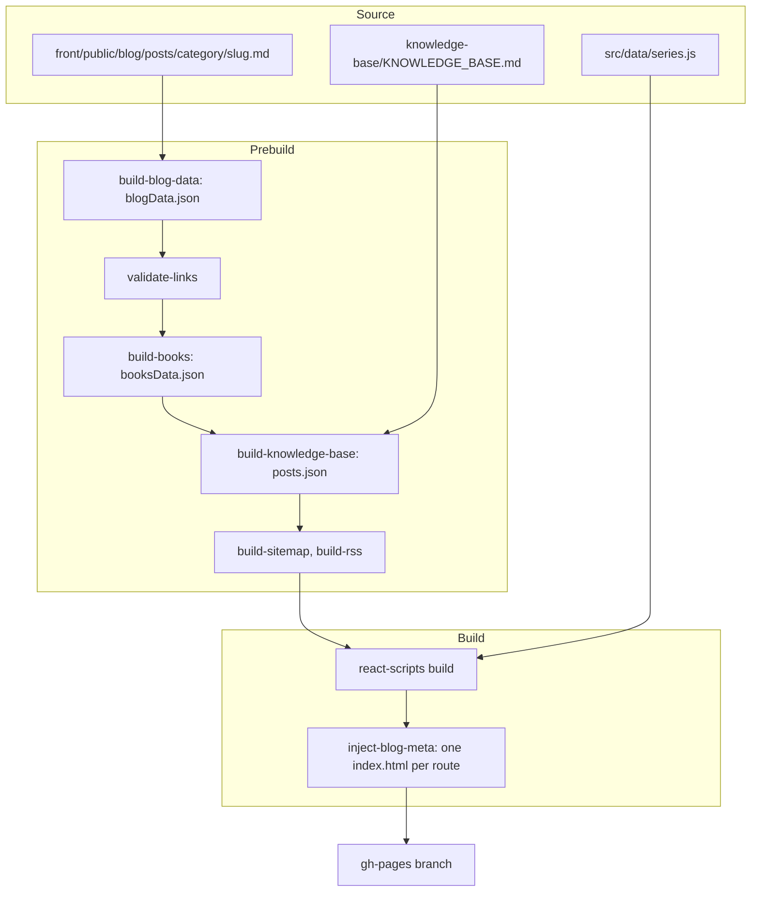

# Architecture

How the site is put together: what runs at build time, what runs in the browser, and why each piece is shaped the way it is.

## The short version

Posts are Markdown files. A chain of Node scripts turns them into a metadata index, a books index, an agent knowledge base, a sitemap, and an RSS feed. Create React App bundles the app. A post-build step writes one HTML file per route so a static host can answer every URL with the right status and meta tags. GitHub Actions deploys the result to GitHub Pages.



## Repository layout

```
.
├── front/                      React app and the content it serves
│   ├── public/
│   │   ├── blog/posts/<category>/<slug>.md    the posts
│   │   ├── blog/headers/       header images (JPEG + WebP) and ATTRIBUTIONS.md
│   │   ├── blog/figures/       in-post figures
│   │   ├── blog/audio{,-es}/   narration manifests (MP3s are served from R2)
│   │   ├── 404.html            deep-link redirect for GitHub Pages
│   │   └── index.html          app shell; decodes the redirect before React boots
│   ├── scripts/                content pipeline (see scripts/README.md)
│   └── src/
│       ├── pages/              one component per route, all lazy-loaded
│       ├── components/         layout, UI, and the blog renderer
│       ├── data/               generated indexes plus series.js and brand.js
│       └── utils/              data access, link resolution, animation variants
├── knowledge-base/             agent-facing index of the blog
├── docs/                       this documentation
└── .github/workflows/          CI/CD
```

## Content model

| Artifact | Produced by | Holds | Read by |
|---|---|---|---|
| `posts/<category>/<slug>.md` | the author | frontmatter and body | everything below |
| `src/data/blogData.json` | `build-blog-data.js` | metadata only: title, date, excerpt, tags, header, reading time, audio URLs | the app, every build script |
| `src/data/booksData.json` | `build-books.js` | books and papers cited in each post's *Going Deeper* section | the Books page, loaded on demand |
| `src/data/series.js` | the author | reading series as ordered slug lists | the Series page |
| `knowledge-base/posts.json` | `build-knowledge-base.js` | concepts, prerequisites, technologies per post | AI agents, the PDF builder |

The slug is the file name and the stable identifier of a post. The category is the folder. Moving a post between folders changes its URL but not its identity, and the app redirects the old address (see [Links between posts](#links-between-posts)).

Post bodies are deliberately not in `blogData.json`. That file is bundled into the app, and carrying 180 bodies made every page download about 3 MB of gzipped text. The post page fetches its own `.md` from `public/blog/posts/` instead, and the Series page fetches bodies only when a reader downloads a series.

## Routing on GitHub Pages

The site lives under `/portfolio`, on a host that only serves files. Three mechanisms make clean URLs work there.

1. **One HTML file per route.** `inject-blog-meta.js` copies `build/index.html` into `build/<route>/index.html` for every post and every page (about, projects, blog, series, books, graph, categories), rewriting the title, description, and Open Graph tags. Crawlers and link previews see the right metadata without running JavaScript, and the route answers with a 200.
2. **Deep links to anything else.** GitHub Pages answers unknown paths with `404.html`, which re-encodes the path as a query string and redirects to the app root. A script in `index.html` decodes it back before React Router starts.
3. **Old links.** The site once used hash routing (`/#/blog/...`). `index.html` rewrites those URLs to clean paths, so old backlinks still land.

Canonical URLs carry a trailing slash (`/blog/research/double-descent/`) because that is the form the host serves with a 200. `canonicalUrl()` in `SEO.jsx`, the sitemap, and the shards all agree on it.

| Route | Page |
|---|---|
| `/`, `/about`, `/projects` | Landing, About, Projects |
| `/blog` | Index with search, tag and category filters |
| `/blog/series`, `/blog/books`, `/blog/graph` | Reading series, books and papers, topic graph |
| `/blog/category/:category`, `/blog/tag/:tag` | Filtered listings |
| `/blog/:category/:slug` | A post |
| `/blog/:slug` | Redirects to the post's canonical address |
| anything else | Not found page, marked `noindex` |

## Links between posts

Posts link to each other as `/blog/<slug>`. Three pieces keep those links correct.

- **At render time**, `resolveInternalHref()` in `src/utils/postLinks.js` maps any link into the site to its canonical route, so the rendered `<a>` points at `/blog/<category>/<slug>` and navigates in the same tab. It also accepts the older absolute and hash forms.
- **At routing time**, `/blog/:slug` redirects to the canonical address, and a post opened under the wrong category redirects to the right one.
- **At build time**, `scripts/validate-links.js` runs in `prebuild` and fails the build on a link to a slug that does not exist or a link written in any other form. `--fix` rewrites the mechanical cases.

## Rendering a post

`MarkdownRenderer.jsx` wraps `react-markdown` with:

- GitHub-flavored Markdown, frontmatter stripping, and math through `remark-math` and `rehype-katex`.
- **Mermaid**, imported dynamically the first time a diagram enters the viewport. Rendered SVGs are cached by content and theme.
- **Prism** through `PrismLight`, with only the grammars the posts use registered. Unregistered languages render as plain monospace.
- Heading IDs derived from the heading text, which also drive the table of contents.
- Relative image paths resolved against `public/blog/figures/<category>/`, with a fallback image if one fails to load.

## Performance budget

Measured on the production build, gzipped JavaScript transferred on first load:

| Page | JavaScript |
|---|---|
| Home | ~180 KB |
| Blog index | ~180 KB |
| A post | ~390 KB, plus Mermaid when the first diagram appears |

What keeps it there:

- Every page is a lazy chunk (`React.lazy` in `App.js`).
- Pages that list posts import `PostCard` directly, not through the `components/features/blog` index, which would drag the Markdown renderer and Mermaid along.
- Heavy data loads where it is used: post bodies, `booksData.json`, Mermaid.

## SEO and sharing

- `SEO.jsx` sets title, description, canonical URL, Open Graph and Twitter tags, and JSON-LD (`BlogPosting` for posts, `BreadcrumbList` where a trail exists).
- The static shards carry the same title and description before JavaScript runs, and each post's header image as its social preview.
- `sitemap.xml` lists every page and post. `rss.xml` carries every post, with its English narration as an audio enclosure. RSS `guid`s never change, so feed readers do not re-announce old posts.

## Quality gates

| Check | Where it runs | Fails on |
|---|---|---|
| `validate-links` | `prebuild`, so every build and every deploy | unknown slugs, non-canonical links between posts |
| `sync:check` | CI, before the build | orphaned audio, Mermaid syntax errors |
| Unit tests (`npm test`) | CI | link resolution regressions |
| `validate-mermaid` | `sync`, `sync:check` | diagrams the renderer cannot parse |
